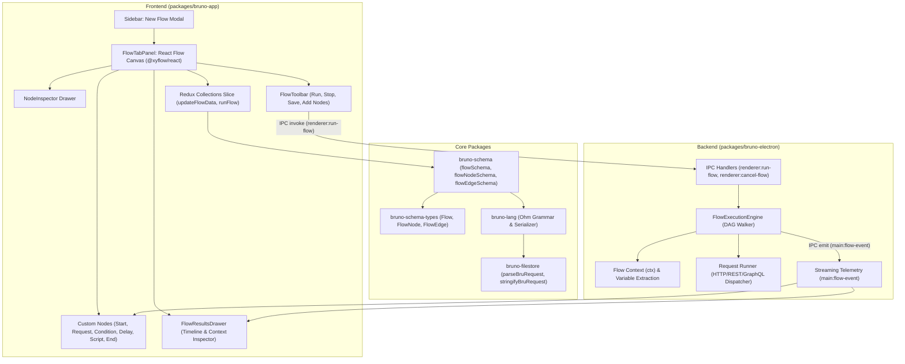

# Bruno API Flows: Comprehensive Architecture, Specification & Implementation Plan

> **Project:** Bruno API Client (`usebruno`)<br />
> **Feature:** API Flows (Visual Workflow Builder & Execution Engine)<br />
> **Status:** Active Development (Phases 1-6 Implemented; automated validation and manual verification limits recorded below)<br />
> **Branch:** `feat/api-flows`

---

## 1. Vision & Core Philosophy

**Bruno Flows** introduces visual, graph-based API workflow design, execution, and automation directly into Bruno. It empowers developers and QA teams to chain requests, branch dynamically, transform data, loop, and automate multi-step integration flows without writing fragile boilerplate scripts.

### Bruno Flows vs. Postman Flows: The Superiority Matrix

| Capability | Postman Flows | Bruno Flows |
| :--- | :--- | :--- |
| **Storage & Git** | Proprietary cloud storage locked to Postman servers. Cannot be tracked in Git, diffed, or reviewed in pull requests. | **100% Plain-Text & Git-Friendly (`.flow.bru`)**. Stored directly in your repo alongside collections. Full Git history, branch merging, and PR reviews. |
| **Expression Language** | Proprietary **FQL (Flows Query Language)** which is restrictive, unfamiliar, and difficult to debug. | **Standard JavaScript / TypeScript & JSONPath**. Write natural JS expressions (`res.body.users.filter(...)`, lodash, regex) directly in nodes. |
| **CI / CD Automation** | Cloud-gated runner requiring paid enterprise plans or credit quotas. | **Free & Open-Source CLI Runner (`bru run --flow`)**. Runs locally and inside GitHub Actions, GitLab CI, or Docker with zero paywalls. |
| **Debugging & Observability** | Opaque error outputs, limited variable inspection, and linear replay. | **Step-by-step live debugger**, real-time variable inspector (`ctx`), breakpoint pauses, and full HTTP wire request/response inspection per node. |
| **Canvas Performance** | Sluggish, resource-heavy web canvas on medium-to-large graphs. | **Ultra-lightweight React Flow (`@xyflow/react`)** engine with virtualized rendering, smooth panning/zooming, and instant responsiveness. |
| **Collection Integration** | Loosely coupled to requests. | Direct file path reference (`itemRef`) to existing collection requests, preserving authentication, scripts, asserts, and environment variable inheritance. |

---

## 2. File Format Specification (`.flow.bru`)

Flows follow Bruno's plain-text, declarative DSL. Stored locally in collection directories (e.g. `flows/user-onboarding.flow.bru`).

```bru
meta {
  name: E2E User Onboarding Flow
  type: flow
  seq: 1
  tags: [e2e, auth, users]
}

config {
  stopOnError: true
  timeout: 60000
}

flow {
  viewport {
    x: 0
    y: 0
    zoom: 1.0
  }

  nodes: [
    {
      "id": "start-1",
      "type": "start",
      "position": { "x": 100, "y": 150 },
      "data": {
        "initialVars": {
          "tenant": "staging"
        }
      }
    },
    {
      "id": "req-login",
      "type": "request",
      "position": { "x": 320, "y": 150 },
      "data": {
        "itemRef": "auth/login.bru",
        "outputVars": {
          "authToken": "res.body.token",
          "userId": "res.body.user.id"
        }
      }
    },
    {
      "id": "cond-auth",
      "type": "condition",
      "position": { "x": 600, "y": 150 },
      "data": {
        "expression": "res.status === 200 && ctx.authToken"
      }
    },
    {
      "id": "req-get-profile",
      "type": "request",
      "position": { "x": 880, "y": 80 },
      "data": {
        "itemRef": "users/get-profile.bru"
      }
    },
    {
      "id": "delay-wait",
      "type": "delay",
      "position": { "x": 880, "y": 250 },
      "data": {
        "durationMs": 2000
      }
    },
    {
      "id": "end-1",
      "type": "end",
      "position": { "x": 1150, "y": 150 }
    }
  ]

  edges: [
    { "id": "e1", "source": "start-1", "target": "req-login" },
    { "id": "e2", "source": "req-login", "target": "cond-auth" },
    { "id": "e3", "source": "cond-auth", "sourceHandle": "true", "target": "req-get-profile" },
    { "id": "e4", "source": "cond-auth", "sourceHandle": "false", "target": "delay-wait" },
    { "id": "e5", "source": "req-get-profile", "target": "end-1" }
  ]
}
```

---

## 3. Node Types & Capabilities

### Phase 1 Core Nodes (Implemented)
1. **Start Node (`start`)**: Flow entry point. Declares initial variables (`ctx`), default test data, and environment parameters.
2. **Request Node (`request`)**: References an existing request in the collection via relative path (`itemRef`). Injects context variables, executes HTTP/REST/GraphQL calls, and extracts output values (`res.body.*`, `res.headers.*`, `res.status`) into `ctx`.
3. **Condition Node (`condition`)**: Evaluates JavaScript boolean expressions against `ctx` and previous `res`. Features dual handles: `true` (green right port) and `false` (red bottom port).
4. **Delay Node (`delay`)**: Pauses execution for a specified duration in milliseconds with cancellation token support.
5. **Script Node (`script`)**: Executes arbitrary JavaScript in the secure QuickJS / Node VM sandbox to transform payloads or compute values.
6. **End Node (`end`)**: Flow termination point. Summarizes execution results and exports final context.

### Future Advanced Nodes (Roadmap)
7. **For-Each / Loop Node (`for-each`)**: Iterates through an array in `ctx`, executing sub-branches per item.
8. **While / Polling Node (`while`)**: Repeatedly calls an endpoint until a condition is met (e.g. async job status polling).
9. **Sub-Flow Node (`sub-flow`)**: Calls another `.flow.bru` as a modular procedure.
10. **Assertion Node (`assert`)**: Validates schema and response values with early-exit or collect-all rules.
11. **Data Source Node (`data-source`)**: Drives flows with CSV/JSON records for automated data-driven testing.

---

## 4. System Architecture



---

## 5. Detailed Implementation Roadmap & Progress

### Phase 1: Core Data Model & File Persistence (Status: COMPLETED)
- [x] Register `flow` item type in `packages/bruno-schema/src/collections/index.js`.
- [x] Create `flowNodeSchema`, `flowEdgeSchema`, and `flowSchema`.
- [x] Add TypeScript definitions in `packages/bruno-schema-types/src/collection/item.ts`.
- [x] Extend Ohm grammar in `packages/bruno-lang/v2/src/bruToJson.js` to parse `flow { ... }` blocks.
- [x] Add flow serialization in `packages/bruno-lang/v2/src/jsonToBru.js`.
- [x] Enable parsing and saving in `packages/bruno-filestore/src/formats/bru/index.ts`.
- [x] Unit test suites for schema, language parser, and filestore persistence (100% passing).

### Phase 2: Flow Execution Engine & Backend IPC (Status: COMPLETED)
- [x] Build `FlowExecutionEngine` in `packages/bruno-electron/src/services/flow-runner/flow-execution-engine.js`.
- [x] Implement DAG validation, cycle detection, and topological node stepping.
- [x] Implement context variable extraction (`res.body.*` & `res.headers.*` -> `ctx.*`).
- [x] Implement dynamic JavaScript condition evaluation and handle routing (`true`/`false`).
- [x] Implement cancellation using `AbortSignal`.
- [x] Wire IPC handler `renderer:run-flow` and real-time streaming channel `main:flow-event`.
- [x] Unit tests for `FlowExecutionEngine` (all 5 test suites passing).

### Phase 3: Visual Flow Builder & Runner UI (Status: COMPLETED)
- [x] Install and configure `@xyflow/react` in `packages/bruno-app`.
- [x] Create `NewFlow` modal component in `packages/bruno-app/src/components/Sidebar/NewFlow/index.jsx`.
- [x] Add "New Flow" actions in collection and folder sidebar context menus.
- [x] Add Flow icons in sidebar tree and tab bars (`IconRoute`).
- [x] Build `FlowTabPanel` visual canvas with pan, zoom, grid, and minimap.
- [x] Create custom interactive node components (`StartNode`, `RequestNode`, `ConditionNode`, `DelayNode`, `ScriptNode`, `EndNode`).
- [x] Build `NodeInspector` configuration drawer for editing node settings, requests, and variable extraction.
- [x] Build `FlowToolbar` with Run Flow, Stop Flow, Save, and Add Node palette.
- [x] Build `FlowResultsDrawer` with step-by-step execution timeline and live context inspector.
- [x] Add `updateFlowData` reducer and register with draft and autosave middlewares.
- [x] Full production build verification with `rsbuild` (0 errors).

### Phase 4: Advanced Flow Features (Status: IMPLEMENTED)
- [x] **Loop Nodes:** `for-each` array iterator and `while` polling loops.
- [x] **Sub-Flows:** Reusable nested flows.
- [x] **Data-Driven Testing:** CSV/JSON dataset runner for flows.
- [x] **Assertions Node:** Dedicated assertion checks with fail-fast options.

Implementation details, connection rules, limits, and validation commands: [Advanced flows](docs/flows-phase4.md). Automated checks cover engine behavior, dataset parsing, child flow loading, and persistence; interactive desktop verification remains a manual check.

### Phase 5: Headless CLI Flow Runner (Status: IMPLEMENTED)
- [x] Add `bru run --flow <path>` to `packages/bruno-cli`.
- [x] Terminal progress reporting with colored step summaries.
- [x] JUnit and JSON export formats for CI/CD reporting.

Usage, shared runtime architecture, reporting, supported flags, and validation: [CLI flows](docs/flows-cli.md).

### Phase 6: AI-Assisted Flow Generation (Status: IMPLEMENTED)
- [x] Natural language flow generator ("Create flow to login, fetch items, and verify inventory").
- [x] Automatic response mapping and edge wiring.

Usage, context boundaries, generated-node scope, and validation: [AI flows](docs/flows-ai.md). Provider responses are mocked in automated tests; live-provider and interactive Electron verification remain manual checks.

### Flow JSON interchange
- [x] Import/export flow definitions through native JSON file dialogs.
- [x] Collection/folder import actions and flow toolbar controls.
- [x] Validate format, preserve graph settings, normalize file references, and omit execution/UI state.

Format and usage: [Flow JSON](docs/flows-json.md). Flow persistence supports both Bru and YAML collections. Regression tests import the provided Sum Example into each format, restart Electron, and verify the computed total is 60.

### Node editing and execution inspection
- [x] Delete nodes and their incident connections through the inspector or canvas keyboard shortcuts.
- [x] Capture per-step input/output snapshots, including failed steps and loop iterations.
- [x] Inspect snapshots from a selected node or the execution timeline.

Usage: [Node editing and inspection](docs/flows-node-inspection.md).

### Post-plan desktop verification
- [x] Create a flow through the collection menu.
- [x] Edit and save a flow, restart Electron, reopen it, execute it, and inspect its output context.
- [x] Stop a running delay and verify cancellation.
- [x] Fix sidebar visibility/opening, graph hydration and reload/save handling, and editor updates during React rendering.

Validation: all 12 Electron flow end-to-end tests passed in a complete suite run, plus 325 related frontend/backend/CLI regression tests. Coverage includes JSON interchange and invalid/cancelled imports, folder imports, datasets, loops, sub-flows, local HTTP execution, and assertions. See [Desktop flow validation](docs/flows-desktop-validation.md). Live AI-provider testing remains a manual check.

---

### Review fixes and editor improvements

- [x] Harden expression syntax, skip blank assertions, protect inspector keyboard controls, and save portable request references.
- [x] Accept internal absolute dataset/sub-flow references while enforcing collection boundaries.
- [x] Propagate request-script runtime variables into flow context on desktop and CLI.
- [x] Add ctx/res completion, animated loop-return paths, an interactive desktop debugger, and canvas validation with node badges.
- [x] Phase 7: shared header, query-parameter, and JSON-object body overrides in desktop, CLI, and the inspector.
- [x] CLI environment injection into ctx, captured-request cURL copying, node duplication, Dagre layout, assertion snippets, and four starter templates.

Usage and override semantics: [Phase 7](docs/flows-phase7.md).

Phase 7 verification: all 21 Electron flow scenarios and 125 targeted regression tests passed, along with lint, syntax/whitespace checks, and the production frontend build.

Latest review follow-up (November 7, 2026): guarded missing starter templates, moved successful body-override feedback to a toast, and simplified assertion synchronization while preserving blank lines and same-node updates. Confirmed Copy as cURL in `FlowTabPanel/NodeExecutionDetails/index.jsx` and added a clipboard interaction test. All 33 flow UI tests and 5 affected Electron scenarios passed, plus lint and whitespace checks. See [Phase 7 review follow-up](docs/flows-phase7.md#review-follow-up--november-7-2026).

Usage and review decisions: [Flow review and improvements](docs/flows-review-improvements.md).

Verification: all 16 desktop flow end-to-end scenarios and 110 related regression tests passed. Flow lint, whitespace checks, and the production frontend build passed. Live AI-provider testing remains manual.

## 6. How to Run & Test

```bash
# Checkout the feature branch
git checkout feat/api-flows

# Start the Electron application with the React frontend
npm run dev

# Or run frontend in web mode
npm run dev:web

# Run test suites
npm test --workspace=packages/bruno-schema
npm test --workspace=packages/bruno-lang
npm test --workspace=packages/bruno-filestore
npx jest packages/bruno-electron/src/services/flow-runner/flow-execution-engine.spec.js
```
