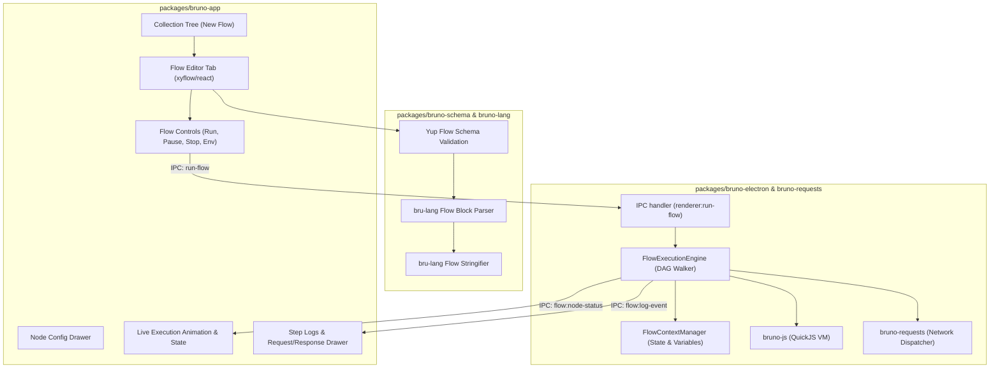

# Bruno Flows: Specification, Architecture & Implementation Roadmap

> **Authoritative Specification & Design Document**  
> **Status:** Draft / Planned  
> **Target:** Bruno Desktop App (`bruno-app`, `bruno-electron`), Core (`bruno-schema`, `bruno-lang`, `bruno-filestore`), and CLI (`bruno-cli`)

---

## 1. Executive Summary & Vision

### 1.1 What is Bruno Flows?
**Bruno Flows** is a visual, graph-based API workflow builder and execution engine integrated directly into the Bruno ecosystem. It allows developers and QA engineers to compose, parameterize, branch, iterate, and run multi-step API sequences visually without writing boilerplate orchestration scripts.

### 1.2 The Core Premise: Why Better than Postman Flows?

| Dimension | Postman Flows | Bruno Flows |
| :--- | :--- | :--- |
| **Storage & Git** | Proprietary cloud format; stored on Postman servers. Impossible to review in standard git PRs or merge conflicts cleanly. | **100% Plain-text & Git-Friendly**. Saved as `.flow.bru` files in your collection folder. Full git history, diffs, branches, and code reviews. |
| **Expression Language** | Proprietary **FQL (Flows Query Language)** which is restrictive, confusing, and requires learning a niche syntax. | **Native JavaScript / TypeScript & JSONPath**. Seamlessly use standard JS (`res.body.users.filter(...)`, lodash, regex) directly in nodes. |
| **Execution & CI/CD** | Cloud-gated runner; requires paid enterprise cloud tiers or credits to run headlessly. | **First-class CLI Support (`bru run --flow`)**. Zero paywalls, offline-first, run directly in GitHub Actions, GitLab CI, or local terminals. |
| **Debugging & Observability** | Opaque node errors, limited intermediate variable inspection, rigid linear replay. | **Step-by-step debugging**, live variable inspector, breakpoint pauses, full HTTP wire logs, and node-level re-execution. |
| **Performance** | Resource-heavy canvas with latency and cloud sync overhead. | **Lightweight & Instantaneous**. Powered by `@xyflow/react` and local IPC execution with sub-millisecond overhead. |
| **Reusability** | Loose linkage to collection items. | Direct reference to existing `.bru` files in the collection, preserving environment inheritance, auth, scripts, and asserts. |

---

## 2. File Format & Specification (`.flow.bru`)

Bruno’s core philosophy is that every artifact must be human-readable, git-diffable, and stored locally in the file system.

### 2.1 File Location
Flows are saved alongside requests in collection folders:
```
my-collection/
├── bruno.json
├── auth/
│   ├── login.bru
│   └── refresh-token.bru
├── users/
│   ├── get-user.bru
│   └── update-profile.bru
└── flows/
    ├── e2e-user-onboarding.flow.bru
    └── bulk-inventory-sync.flow.bru
```

### 2.2 Syntax & Structure
A `.flow.bru` file uses the standard Bruno declarative syntax:

```bru
meta {
  name: E2E User Onboarding Flow
  type: flow
  seq: 1
  tags: [e2e, auth, users]
}

config {
  stopOnError: true
  timeout: 60000
  env: Development
}

flow {
  viewport {
    x: 0
    y: 0
    zoom: 1.0
  }

  nodes [
    {
      id: "start-1"
      type: "start"
      position: { x: 100, y: 200 }
      data: {
        initialVars: {
          testUserEmail: "qa-{{$guid}}@example.com"
        }
      }
    },
    {
      id: "req-login"
      type: "request"
      position: { x: 350, y: 200 }
      data: {
        itemRef: "auth/login.bru"
        overrides: {
          body: {
            email: "{{testUserEmail}}"
          }
        }
        outputVars: {
          authToken: "res.body.token"
          userId: "res.body.user.id"
        }
      }
    },
    {
      id: "cond-check-auth"
      type: "condition"
      position: { x: 650, y: 200 }
      data: {
        expression: "res.status === 200 && ctx.authToken"
      }
    },
    {
      id: "req-create-profile"
      type: "request"
      position: { x: 950, y: 120 }
      data: {
        itemRef: "users/update-profile.bru"
        overrides: {
          headers: {
            Authorization: "Bearer {{authToken}}"
          }
          body: {
            userId: "{{userId}}"
            status: "active"
          }
        }
      }
    },
    {
      id: "log-failure"
      type: "script"
      position: { x: 950, y: 320 }
      data: {
        code: "console.error('Authentication failed with status:', res.status);"
      }
    },
    {
      id: "end-success"
      type: "end"
      position: { x: 1250, y: 200 }
      data: {
        outputSummary: {
          createdUserId: "{{userId}}"
          completedAt: "{{$isoTimestamp}}"
        }
      }
    }
  ]

  edges [
    {
      id: "e-start-req"
      source: "start-1"
      target: "req-login"
    },
    {
      id: "e-login-cond"
      source: "req-login"
      target: "cond-check-auth"
    },
    {
      id: "e-cond-true"
      source: "cond-check-auth"
      sourceHandle: "true"
      target: "req-create-profile"
    },
    {
      id: "e-cond-false"
      source: "cond-check-auth"
      sourceHandle: "false"
      target: "log-failure"
    },
    {
      id: "e-profile-end"
      source: "req-create-profile"
      target: "end-success"
    }
  ]
}
```

---

## 3. Node Types & Capabilities

### 3.1 Foundational Nodes (MVP)

1. **Start Node (`start`)**
   - Flow entrypoint.
   - Declares flow-scoped initial variables, default mock parameters, or CLI overrides.
2. **Request Node (`request`)**
   - References an existing `.bru` request file by relative path or UID.
   - Allows selective overrides (headers, query params, request body).
   - Defines **Output Mappings**: maps response properties (`res.body.*`, `res.headers.*`, `res.status`, `res.responseTime`) into flow context variables (`ctx.*`).
   - Visual status badge: HTTP status code, duration, method chip (GET/POST/etc.).
3. **Condition Node (`condition`)**
   - Two output handles: `true` (green) and `false` (gray/red).
   - Evaluates a JavaScript boolean expression with access to `ctx` and previous `res`.
   - Supports multi-branch mode (`switch-case` with multiple custom output ports).
4. **Delay / Wait Node (`delay`)**
   - Pauses execution for a specified duration in milliseconds (supports variable duration like `{{retryAfterMs}}`).
5. **Script / Transform Node (`script`)**
   - Executes arbitrary JavaScript in the secure QuickJS / Node VM sandbox.
   - Capable of complex data transformations (e.g., shaping response arrays into a payload for a subsequent batch API).
6. **End Node (`end`)**
   - Explicit termination port.
   - Aggregates metrics and exposes final output dictionary.

### 3.2 Advanced Nodes (Post-MVP)

7. **Loop / Iterator Node (`for-each` / `while`)**
   - Iterates over an array in `ctx` (e.g. `ctx.userList`), running connected sub-branches per item.
   - While loop mode: repeats until a condition is satisfied (e.g. polling an async job status until `status === 'COMPLETED'`) with configurable max-iterations and backoff.
8. **Sub-Flow Node (`sub-flow`)**
   - Calls another `.flow.bru` as a nested reusable procedure, passing parameters and receiving outputs.
9. **Assertion Node (`assert`)**
   - Explicit assertions comparing expected vs actual values with fail-fast or collect-all policies.
10. **Data Source Node (`data-source`)**
    - Feeds CSV or JSON data files into the flow for data-driven testing.

---

## 4. Architecture & Technical Design

### 4.1 System Architecture



### 4.2 The Flow Execution Engine (`FlowExecutionEngine`)
The execution engine is an asynchronous, event-driven DAG (Directed Acyclic Graph) engine that runs in `bruno-electron` (desktop) and `bruno-cli` (headless).

#### Execution Lifecycle:
1. **Validation & Topological Analysis:**
   - Verify start node exists.
   - Detect non-looping cycles or unreachable nodes.
   - Compile variable dependencies.
2. **Context Initialization:**
   - Inherits Collection Variables, Environment Variables, and Global Variables.
   - Initializes a local `FlowContext` (`ctx`) for dynamic flow-level values.
3. **Step Execution:**
   - Traverse queue of ready nodes.
   - For `request` nodes: Interpolate template tags (`{{ctx.var}}`), dispatch request via `bruno-requests`, extract configured outputs into `ctx`.
   - For `condition` nodes: Evaluate condition against `ctx` and `res`, activate corresponding output edge.
   - For `delay` nodes: Asynchronous timeout with cancellation token listener.
   - For `script` nodes: Run in `bruno-js` sandbox with read/write access to `ctx`.
4. **Streaming Telemetry via IPC:**
   - `flow:started` (timestamp, totalNodes)
   - `flow:node-started` (nodeId)
   - `flow:node-completed` (nodeId, status, duration, resSummary, extractedVars)
   - `flow:node-failed` (nodeId, error)
   - `flow:finished` (summary, totalDuration, passCount, failCount)
5. **Interactive Controls:**
   - `cancelFlow(runId)`: Immediately aborts pending network sockets and execution loops.
   - `pauseFlow(runId)` / `stepFlow(runId)`: Pauses at next node for visual step-through debugging.

---

## 5. UI/UX Design Specifications (`bruno-app`)

### 5.1 Visual Flow Builder Canvas
- **Engine:** `@xyflow/react` (React Flow) – high-performance, modular, supports custom nodes, pan, zoom, minimap, and snap-to-grid.
- **Custom Node Components:**
  - `BrunoRequestNode`: Method badge (GET/POST with color accents), request name, path preview, dynamic status indicator (idle: gray, executing: pulsing blue, success: emerald green, failure: crimson red).
  - `BrunoConditionNode`: Diamond/rounded logic card with conditional expression and dual True/False connector handles.
  - `BrunoDelayNode`: Clock icon with duration badge.
  - `BrunoScriptNode`: Code terminal icon with snippet preview.
- **Connecting Edges:**
  - Animated bezier lines with data-flow pulses when active.
  - Deletable with backspace/delete key or click-to-remove.

### 5.2 Node Inspector Panel (Slide-out Drawer)
When a node is clicked:
- **For Request Nodes:**
  - Collection request picker (searchable tree dropdown).
  - "Open Request in Tab" shortcut.
  - Variable overrides table (Key-Value editor for headers, params, body).
  - Response extraction table (JSONPath expression -> Context variable name).
- **For Condition Nodes:**
  - Code editor (monaco/codemirror) for the JavaScript expression with autocomplete for `ctx.*` and `res.*`.
- **For Script Nodes:**
  - CodeMirror editor with syntax highlighting and preloaded `bru` helper documentation.

### 5.3 Execution Panel & Debugger
- **Top Bar:** Run Button, Environment selector dropdown, Speed slider (Realtime / 500ms delay between steps for visual observation / Step-by-Step), Pause and Stop buttons.
- **Bottom Drawer (Runner Results):**
  - **Timeline:** Sequence of executed nodes with start time, latency, and status.
  - **Live State Inspector:** Real-time view of all variables in `ctx`.
  - **Request/Response Viewer:** Inspect the exact HTTP exchange for any clicked node in the flow run.

---

## 6. Implementation Roadmap & Milestones

### Milestone 1: Schema, Parser & File Persistence (Week 1–2)
- [ ] Add `flow` to item type enum in `packages/bruno-schema/src/collections/index.js`.
- [ ] Define `flowSchema`, `flowNodeSchema`, `flowEdgeSchema` in `bruno-schema`.
- [ ] Update `packages/bruno-lang` to parse `flow { ... }` blocks to JS objects and serialize back to `.bru`.
- [ ] Update `packages/bruno-filestore` to recognize `*.flow.bru` files on disk, read and watch them.

### Milestone 2: Flow Execution Engine in Backend (Week 2–3)
- [ ] Implement `FlowExecutionEngine` in `packages/bruno-electron` / `packages/bruno-requests`.
- [ ] Graph resolution (detect start node, topological traversal).
- [ ] Flow variable context manager (`ctx`).
- [ ] Response mapping and variable extraction logic (`JSONPath` / dot-notation).
- [ ] IPC channels: `renderer:run-flow`, `renderer:cancel-flow`, and event stream `flow:status-update`.
- [ ] Unit tests for multi-step request flows, conditions, and error halts.

### Milestone 3: Visual Canvas & Flow Creation UI (Week 3–4)
- [ ] Integrate `@xyflow/react` into `packages/bruno-app`.
- [ ] Add "New Flow" button in sidebar collection/folder context menus.
- [ ] Build `FlowTabPanel` and register it in `RequestTabPanel/index.js`.
- [ ] Build custom node views (`RequestNode`, `ConditionNode`, `DelayNode`, `ScriptNode`, `StartNode`, `EndNode`).
- [ ] Build Drag-and-Drop Node Palette (Sidebar / Floating bar).
- [ ] Build Node Configuration Drawer (Request selector, variable mapping, condition editor).
- [ ] Save & dirty-state tracking (syncing canvas changes to Redux and saving to disk).

### Milestone 4: Interactive Flow Runner & Visual Telemetry (Week 4–5)
- [ ] Flow control bar (Run, Stop, Pause, Step, Environment Selector).
- [ ] Animated active edges and live node state highlights (pulsing ring while running, green check on complete, red alert on error).
- [ ] Bottom drawer with execution logs, variable inspector, and request/response viewer for each step.
- [ ] End-to-end integration tests using Playwright.

### Milestone 5: CLI Headless Flow Runner (`bru run --flow`) (Week 5–6)
- [ ] Add `--flow <path>` flag to `packages/bruno-cli`.
- [ ] Terminal progress reporting with spinner and colored step summaries.
- [ ] JSON / JUnit export for CI/CD test reports.

---

## 7. Comparison: Bruno Flows vs. Postman Flows Feature Matrix

| Feature | Postman Flows | Bruno Flows |
| :--- | :---: | :---: |
| **Storage** | Cloud DB (Proprietary) | **Git-friendly Local File (`.flow.bru`)** |
| **Offline Support** | Limited / Partial | **100% Offline-First** |
| **Expression Language** | FQL (Flows Query Language) | **JavaScript / TypeScript (ES6+)** |
| **CI/CD Execution** | Requires Cloud Runner / Paid Tier | **Free & Open Source CLI (`bru run`)** |
| **Response Variable Mapping** | Complex Block Chaining | **Direct JSONPath / Dot notation** |
| **Branching / Logic** | Basic condition blocks | **Multi-branching Switch / JS Expressions** |
| **Scripting Sandbox** | Limited | **Full QuickJS / Node Sandbox** |
| **Debugging** | Basic run log | **Step-by-step debug, live context inspector** |
| **Speed & Resource Usage** | Heavy | **Ultra-lightweight React Flow engine** |

---

## 8. Next Steps & Execution

1. **Review & Approval:** Align on the data model syntax (`.flow.bru`) and node definitions.
2. **Branch Setup:** Create feature branch `feat/flows-engine`.
3. **Begin Phase 1:** Implement schemas in `bruno-schema` and parsing in `bruno-lang`.
